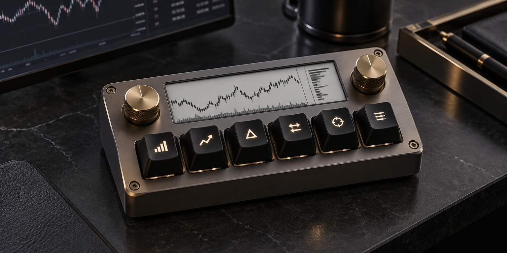

<div align="center">
  
</div>

# SIXSHARP

<p align="center">
  <a href="https://diufoundry.online"></a>&nbsp;
  &nbsp;
  &nbsp;
  
</p>

<p align="center">
  <b>Don't just make the interface look finished. Make the system make sense.</b><br/>
  <em>Multi-asset quantitative research workbench: deterministic backtesting, slippage modeling, position sizing, and drawdown telemetry.</em>
</p>

---

## 📈 Core Capabilities

> **Research prototype:** Performance metrics and strategy results depend on the input data, model assumptions, fees, and slippage settings. Backtests do not predict future returns. This is not investment advice and should not be treated as a live-trading or execution platform unless such integrations are separately implemented and verified.

Sixsharp equips quantitative developers and algorithmic traders with verifiable execution assumptions:

- **Deterministic Backtesting** — Realistic historical simulation modeling exchange latency, fees, and market impact.
- **Dynamic Position Sizing** — Kelly criterion, volatility targeting, and risk parity portfolio allocation engines.
- **Drawdown & VaR Telemetry** — Value-at-Risk (VaR), Sharpe / Sortino ratio metrics, and maximum adverse excursion inspection.
- **Strategy Visualizer** — Interactive equity curve inspection with multi-asset comparative overlays.

---

## 🛠️ Architecture & Engine

```text
[ MARKET DATA INGESTION ] ──► [ STRATEGY ENGINE ] ──► [ SLIPPAGE MODEL ]
                                                            │
                                                            ▼
[ PERFORMANCE DASHBOARD ] ◄── [ RISK ANALYTICS ] ◄── [ ORDER SIMULATOR ]
```

- **Stack**: React, TypeScript, Tailwind CSS, Vite
- **Analytics Core**: Mathematical vectorized computation, statistical risk distribution
- **Design System**: Slate clay surfaces, ocean-glass telemetry cards, Instrument Serif, JetBrains Mono

---

## ⚡ Quickstart

```bash
# Clone the repository
git clone https://github.com/Kishordiu/sixsharp.git
cd sixsharp

# Install dependencies
bun install

# Run the quantitative research workbench
bun run dev
```

---

<p align="center">
  <b>RESEARCH → BUILD → TEST → SHIP</b><br/>
  <sub>A digital product by <a href="https://diufoundry.online">DIU Foundry</a> · Engineered by K. Kishor Kumar</sub>
</p>
